

  

  <strong>Prepare equipment maintenance contracts, issue PDFs, and follow every revision under one reference.</strong>

  
  
  

  <a href="#the-problem">Problem</a> ·
  <a href="#the-solution">Solution</a> ·
  <a href="#app-walkthrough">Walkthrough</a> ·
  <a href="#application-architecture">Architecture</a> ·
  <a href="#data-architecture">Data model</a> ·
  <a href="#engineering-decisions">Engineering</a> ·
  <a href="#testing-and-limitations">Testing</a>

## The problem

To prepare an equipment maintenance contract, staff had to look up equipment in the ERP, find the applicable rates, and enter coverage and exclusions into a Word template. Manual lookups and transcription made contracts harder to prepare consistently and sometimes led to contracts being signed below the applicable price.

After issuance, historical contracts were available as scanned files. Staff lacked a searchable register that showed which contracts had been issued and who prepared them.

## The solution

Contract Creator guides staff through equipment selection, coverage, exclusions, and pricing, then generates a PDF from a Word template. A searchable register keeps the issued PDFs, their authors, and their follow-up history together.

  <a href="img/dashboard.png">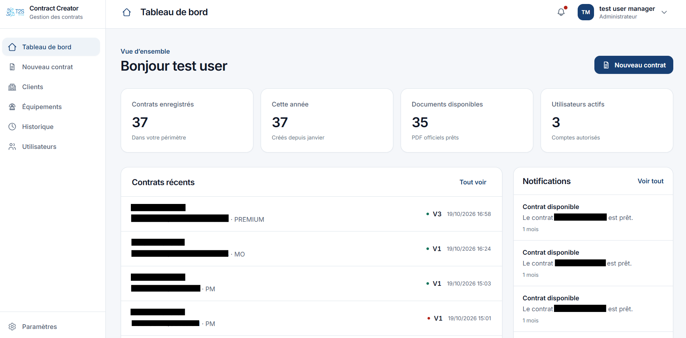</a>

*Recent contracts, available documents, and notifications in one staff workspace.*

## App walkthrough

Follow preparation, revision, and document follow-up. The screenshots illustrate individual steps rather than one continuous version sequence.

[Issue a contract](#issue-a-contract) → [Revise an issued contract](#revise-an-issued-contract) → [Record receipt and signature](#record-receipt-and-signature)

### Issue a contract

Choose a client, select equipment from that client’s list, and set the maintenance coverage and exclusions. The wizard calculates a default price for each equipment line. After staff review the totals, the app generates the contract PDF and records it as V1.

  <a href="img/contract-client-selection.png">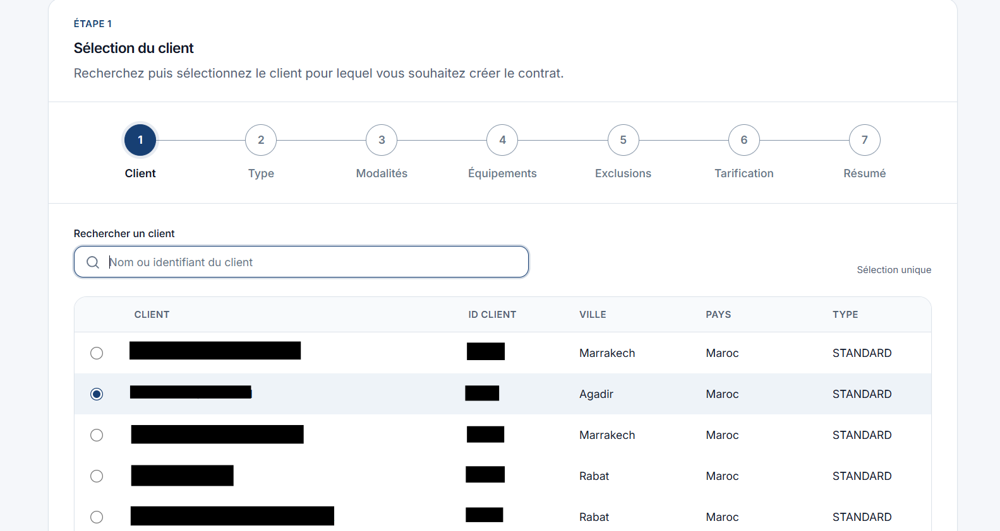</a>

<strong>Select equipment and define its coverage</strong>

Search the selected client’s equipment by identifier, designation, or serial number, then choose the items to include in the contract.

  <a href="img/contract-equipment-coverage0.png">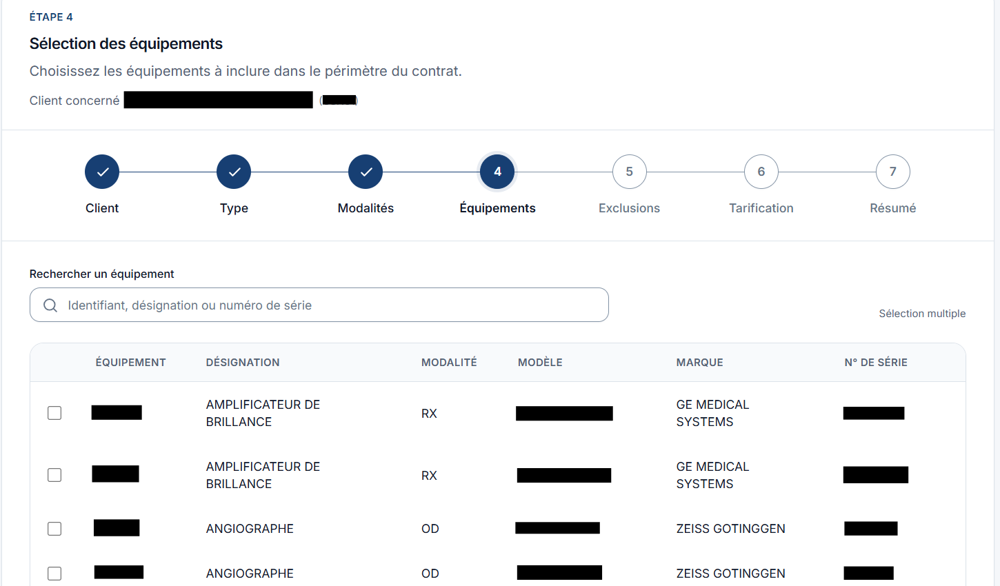</a>

Set exclusions for each equipment item. The form distinguishes optional selections from mandatory exclusions.

  <a href="img/contract-equipment-coverage1.png">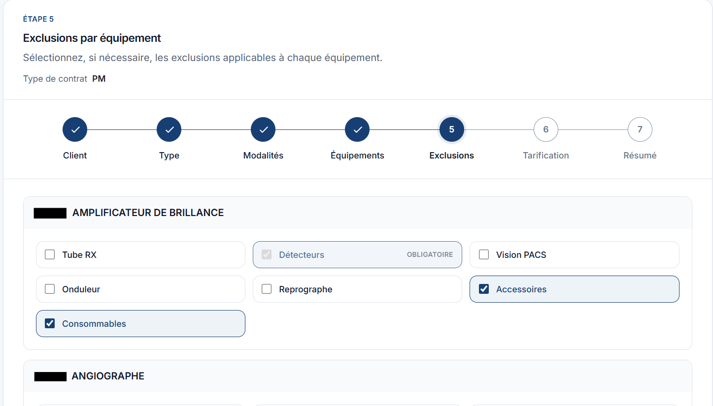</a>

*Equipment scope and exclusions are defined before the pricing review.*

The pricing review brings together equipment-line rates, annual totals, tax, and the amount for each billing period.

  <a href="img/contract-tarification.png">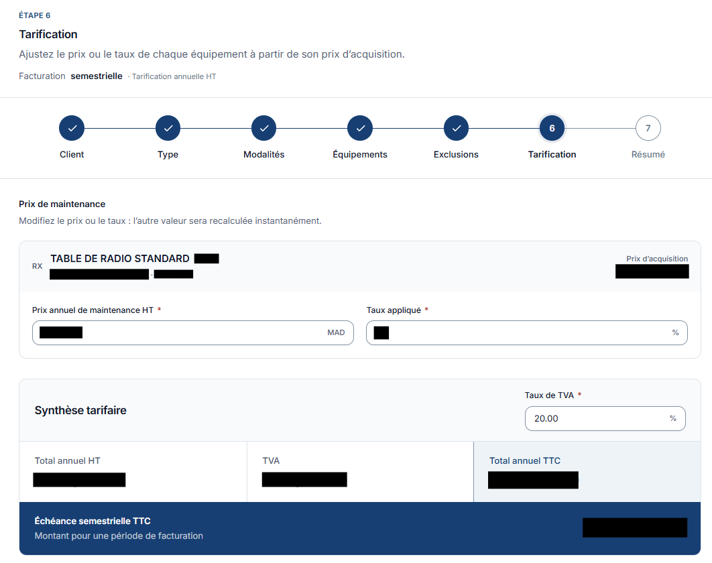</a>

*Review the equipment pricing before issuing the contract.*

<strong>Review a pricing exception</strong>

An authorized user can adjust a rate or price on an equipment line. The app recalculates the totals and records the exception.

### Revise an issued contract

Open the contract in history and start a revision. The wizard restores the previous inputs for editing. When staff issue the correction, the register keeps both PDFs under the same contract reference and records the revision author, reason, and changes.

  <a href="img/contract-history0.png">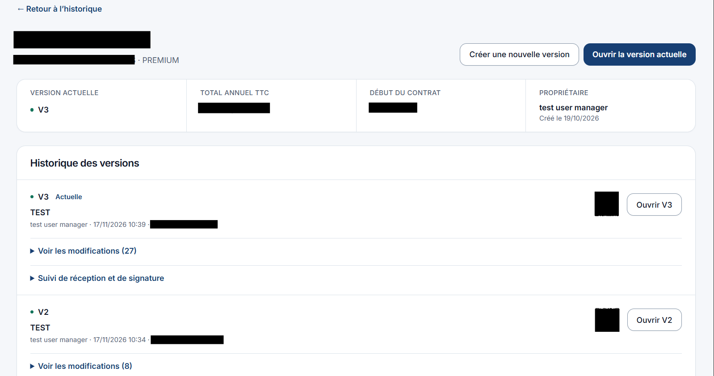</a>

*Earlier issues remain accessible while the current version is clearly identified.*

<strong>Find a contract in the register</strong>

Search by reference, client, or identifier, then filter by author, contract type, status, and dates.

  <a href="img/contract-history.png">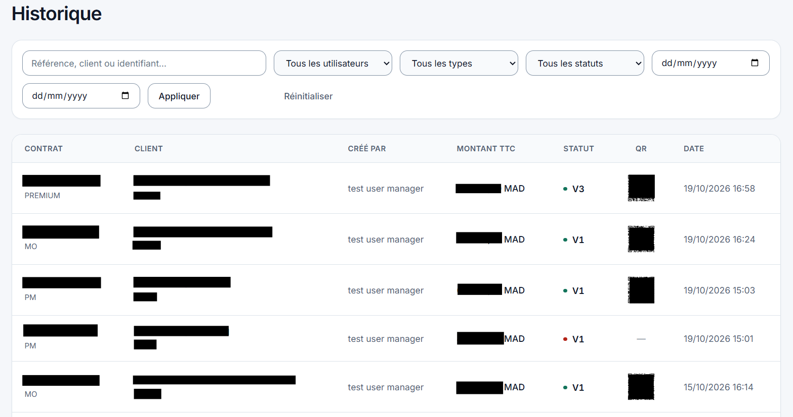</a>

### Record receipt and signature

Staff record receipt and signature against the relevant version. The register stores timestamps for those milestones and provides a place to save a link to the signed document.

The version page keeps the revision’s change summary and follow-up together. This example shows changes to duration, payment terms, and periodicity, with receipt marked for the technico-commercial staff and client. The client-signature checkbox remains unchecked.

  <a href="img/contract-revision-changes-follow-up.png">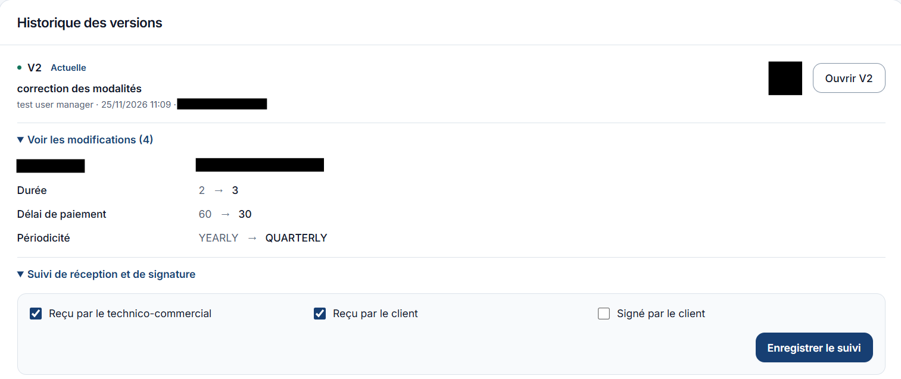</a>

*Document availability and signature status are separate: generating a PDF does not establish that it has been received or signed.*

## Application architecture

Python and Django handle sign-in, the contract wizard, pricing, and history. Django templates, HTMX, and Tailwind CSS provide the staff interface. Client and equipment reference data from the ERP inform equipment selection and pricing. Pricing also uses maintained rules for the selected coverage and equipment configuration.

    <a href="img/application-architecture.svg">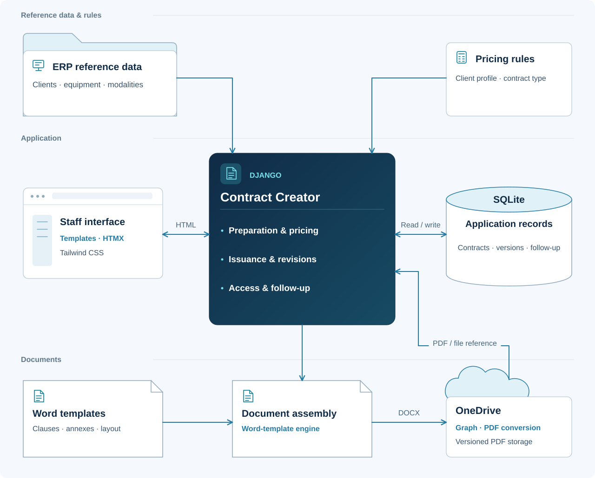</a>

*The Django block groups the application’s core responsibilities. Arrows show the reference-data, persistence, and document flows.*

<strong>Document generation and access</strong>

The document generator populates Word templates with contract details, equipment tables, exclusions, and pricing. The application uses Microsoft Graph for PDF conversion and OneDrive storage. Staff use authenticated accounts, and permissions control actions such as pricing adjustments and account administration.

  

| Component | Responsibility |
| --- | --- |
| Python and Django | Authentication, wizard validation, pricing, revisions, and history. |
| Templates, HTMX, Tailwind CSS | Staff pages and interactive workflow. |
| Reference-data adapter | Client and equipment data and maintained pricing inputs. |
| Word-template engine | Assemble contract details, equipment annexes, coverage, and exclusions. |
| Microsoft Graph and OneDrive | Convert documents to PDF and store issued files. |
| SQLite | Application state, versions, authorship, and follow-up in the documented build. |

The application defines standard, elevated, and manager roles. Managers have broader history and account-administration access. DOCX export permissions depend on the application build.

## Data architecture

The contract record retains one reference across revisions. Each issued version has its own number, author, timestamp, saved inputs, and PDF reference. Receipt and signature are recorded for the specific version.

  <a href="img/data-architecture.svg">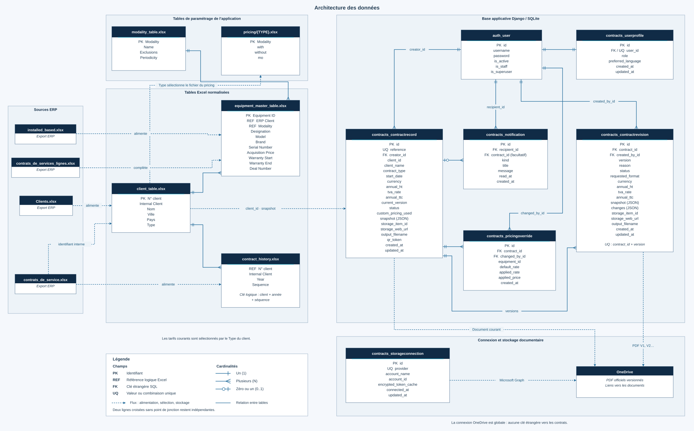</a>

*Reference-data and application schema.*

<strong>Identity, integrity, and history</strong>

The data model enforces unique contract references and unique version numbers within a contract. The wizard checks that selected equipment belongs to the chosen client and that exclusions apply to the selections. Saved inputs and change summaries preserve the context for each revision.

## Engineering decisions

**Calculate defaults and record exceptions.** Pricing rules account for the client profile, contract type, equipment modality, and applicable exclusions. Recording overrides makes exceptions traceable. Default prices depend on the quality of the source data and maintained rules.

**Preserve each issued version.** A correction creates a new PDF and saves a new snapshot under the existing contract reference. The wizard checks restored selections against current reference data before issuing the revision.

<strong>Fit document generation into existing tools</strong>

Word templates give staff a familiar format for maintaining contract layouts. Generation relies on the template markers and layout being maintained. OneDrive fits the company’s existing Office environment and keeps the generated documents in its document storage.

## Testing and limitations

This showcase includes screenshots of contract preparation, pricing review, revisions, and document follow-up. Automated test results are not included in this repository.

- **Pricing:** default prices depend on the ERP reference data and maintained rules; staff review totals before issuance.
- **Documents:** generation depends on maintained Word-template markers and the Microsoft Graph / OneDrive integration.
- **Follow-up:** receipt and signature are recorded by staff for each version. PDF availability alone does not establish receipt or signature.

---

*This repository showcases the project. The codebase is not shared because it contains sensitive business data and related business information. Identifying details in screenshots have been redacted; client data, pricing tables, and legal templates remain private.*
